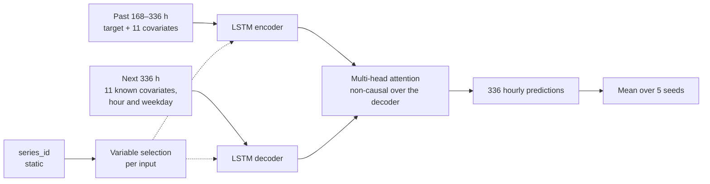

<div align="center">

<h1>Forecasting Load from Known Future Covariates</h1>

<p><strong>A sequence problem that turned out to be a regression problem.</strong></p>

<p>96 hourly series, forecast 14 days ahead, with the covariates for those 14 days given in advance.<br>
A 5-seed Temporal Fusion Transformer scores WAPE 14.48 against 34.41 for the seasonal baseline.</p>

[](#about) [](https://github.com/xitij27/known-covariate-forecasting/actions/workflows/ci.yml) [](https://github.com/xitij27/known-covariate-forecasting/releases/tag/v1.0.0) [](src/loadforecast/tft.py) [](https://arxiv.org/abs/1912.09363) [](#dataset) [](experiments/experiment-13/run-3/kp-experiment-13a-tft-multiseed-run3.ipynb) [](LICENSE) [](https://github.com/xitij27/known-covariate-forecasting/commits/main)

<p>
  <a href="#the-finding"><strong>The finding</strong></a>
  &nbsp;&nbsp;|&nbsp;&nbsp;
  <a href="#experiments">Experiments</a>
  &nbsp;&nbsp;|&nbsp;&nbsp;
  <a href="#run-it">Run it</a>
  &nbsp;&nbsp;|&nbsp;&nbsp;
  <a href="docs/experiments.md">Full experiment log</a>
  &nbsp;&nbsp;|&nbsp;&nbsp;
  <a href="https://github.com/xitij27/known-covariate-forecasting/releases/tag/v1.0.0">Checkpoints</a>
</p>

<picture>
  <source media="(prefers-color-scheme: dark)" srcset="docs/figures/backtest-dark.png">
  
</picture>

<sub>unit_080 over the last 14 days of the training data, held out as a backtest. The weekly profile scores WAPE 37.2 on this series<br>
and cannot see the load spikes. A model reading the known covariates scores 14.3 and follows them.</sub>

</div>

<br>

## The finding

The task looked like time-series forecasting, and the first three models were LSTMs that
forecast 24 hours at a time and fed their own predictions back in. None beat the seasonal
baseline. The input for the forecast block holds every covariate and no target, so target
lags do not exist at prediction time. The target is largely a per-hour function of those
covariates.

<table>
  <tr>
    <td align="center" width="25%" valign="top"><h3>14.48</h3><sub>leaderboard WAPE of the TFT ensemble, 58% below the seasonal mean (34.41)</sub></td>
    <td align="center" width="25%" valign="top"><h3>21.0</h3><sub>WAPE of a plain linear regression on the covariates, when no LSTM had beaten the baseline (31.4)</sub></td>
    <td align="center" width="25%" valign="top"><h3>3.1</h3><sub>WAPE lost to training windows that stopped short of the forecast start (17.91 to 14.77 once fixed)</sub></td>
    <td align="center" width="25%" valign="top"><h3>0.999998</h3><sub>correlation between the released checkpoints, run on a CPU, and the predictions that were scored</sub></td>
  </tr>
</table>

After the reframe, the gains came in three ways:

- **Matching the loss to the metric.** WAPE is an absolute error, so an MAE objective beat L2
  by 1.08 on its own.
- **Reading the covariates around each hour.** Leads, lags and rolling statistics of the
  covariates, which are all known for the forecast block, took LightGBM to CV 14.80.
- **Architectures that use both history and known future.** Past LightGBM, each new model
  bought tenths of a point. They converge to nearly the same function: LightGBM and XGBoost
  residuals correlate at r = 0.9955, the TFT and the GRU at r = 0.973.

<picture>
  <source media="(prefers-color-scheme: dark)" srcset="docs/figures/leaderboard-dark.png">
  
</picture>

<sub>Public validation leaderboard. The learned models sit within 1 WAPE of each other, 20 below the seasonal mean.</sub>

> [!NOTE]
> Cross-validation ranked the TFT last and the leaderboard ranked it first. The GRU had
> early-stopped on the block it was scored on, which made its CV 0.57 too optimistic; the
> TFT held that block out. The TFT was first rejected on that comparison, and a blend fitted on
> the same numbers gave it weight 0.0. Every early-stopping model here now stops on the
> 336 hours before the scored block ([`cv.py`](src/loadforecast/cv.py)).

## How the model works



The [Temporal Fusion Transformer](https://arxiv.org/abs/1912.09363) reads up to 336 hours of
history and the known covariates for the 336 hours ahead, and predicts the whole block in one
pass. It is trained with MAE on the original target scale. Attention may look forward across
the decoder because every decoder input is a known covariate; no target enters it.

The shipped model is five of these, seeds 42, 7, 13, 99 and 1234, each trained on the full
history for 10 epochs (the median best epoch from cross-validation), with their predictions
averaged. Its variable selection ranks `network_pressure_forecast` (0.173) and
`queue_pressure_forecast` (0.147) highest and the target history at only 3.1%.

## Results

| Model | CV WAPE, 3 folds | Leaderboard WAPE |
|---|---|---|
| Naive last value | 54.55 ✓ | 48.10 |
| Seasonal mean (weekday × hour) | 32.95 ✓ | 34.41 |
| LightGBM, MAE loss, covariate context | 14.81 ± 0.65 ✓ | 15.48 |
| BiGRU encoder-decoder, 5 seeds | 14.20 ¹ | 14.77 |
| LightGBM + gated MLP blend | 14.47 | 14.68 |
| **Temporal Fusion Transformer, 5 seeds (shipped)** | 14.72 ± 0.34 ² | **14.48** ✓ |
| Best entry on the leaderboard (another team) | | 13.05 |

<sub>✓ reproduced by this repository: CV by `loadforecast cv`, and the TFT's leaderboard predictions by `loadforecast predict` from the released checkpoints.<br>
¹ Early-stopped on the block it reports, so optimistic by about 0.57. ² One seed, under the protocol that holds the scored block out.<br>
A single-seed TFT scored 14.36 on the leaderboard, but that run did not keep its weights.</sub>

## Experiments

Thirteen experiments, May to August 2026. Each folder in [`experiments/`](experiments/) holds
the Kaggle notebooks as they were run and a README of what was tried and why.

| # | Experiment | What it established | Score | Compute |
|---|---|---|---|---|
| 1–3.1 | [LSTM](experiments/experiment-1) with a 24-hour [autoregressive](experiments/experiment-2) [rollout](experiments/experiment-3.1) | Never beat the baseline; a linear regression on the covariates did (21.0) | LB 37.16 (exp 1) | Kaggle T4 |
| 3.2 | [Direct regression](experiments/experiment-3.2) | The reframe: one row per hour, covariates in, target out | 16.53, one split | CPU |
| 4 | [LightGBM, honest CV](experiments/experiment-4) | MAE loss, `series_id`, covariate leads and lags | CV 14.80 | CPU, 1 min |
| 5–6 | [Tuning, ensembles](experiments/experiment-5), [XGBoost](experiments/experiment-6) | Tree models saturate: residual r = 0.9955 | LB 14.92 | CPU |
| 7 | [Gated MLP and blend](experiments/experiment-7) | First neural model to beat the trees | LB 14.68 | Kaggle |
| 8–10 | [TiDE](experiments/experiment-8), [spike losses, Chronos-2](experiments/experiment-9), [new features](experiments/experiment-10) | All rejected: other models and losses learned the same function | CV: TiDE 16.37, Chronos-2 18.7 | Kaggle |
| 11 | [BiGRU / BiLSTM encoder-decoder](experiments/experiment-11) | The final-fit window bug, worth 3.1 WAPE | LB 14.77 | Kaggle |
| 12 | [Temporal Fusion Transformer](experiments/experiment-12) | Best leaderboard score, after CV had ranked it last | LB 14.36 | 11.45 GPU-h |
| 13 | [5-seed final fit](experiments/experiment-13) | The shipped checkpoints; seed noise as large as the effect | LB 14.48 | 5.84 GPU-h |

The whole story, with every rejected idea and the lessons on evaluation, is in
[docs/experiments.md](docs/experiments.md).

## Run it

Tested on Python 3.12. The TFT extra pins `torch 2.10.0`, `lightning 2.6.5` and
`pytorch-forecasting 1.8.0`, the versions the checkpoints were trained with.

```bash
git clone https://github.com/xitij27/known-covariate-forecasting
cd known-covariate-forecasting
python -m venv .venv && source .venv/bin/activate
pip install --extra-index-url https://download.pytorch.org/whl/cpu -e ".[tft,dev]"

loadforecast download                 # dataset from Hugging Face into data/ (170 MB)
loadforecast cv                       # baselines + LightGBM CV, about 2 minutes on 8 cores
loadforecast fetch-model              # the 5 TFT checkpoints into models/tft/ (55 MB)
loadforecast predict --model tft      # validation predictions, about 30 s on a CPU
```

> [!TIP]
> `pytest` runs the whole pipeline, TFT training included, on a small synthetic panel in
> about 20 seconds, with no download. It is the quickest check that an install works.

`loadforecast predict --input-dir DIR` also takes a test-style folder (`train.csv`,
`test_input.csv`, `forecast_index_test.csv`). Retraining the TFT (`loadforecast fit-tft`) or
cross-validating it (`loadforecast cv --model tft`) needs a GPU: the shipped fit took
5.84 GPU hours on two NVIDIA T4s, in
[this Kaggle notebook](experiments/experiment-13/run-3/kp-experiment-13a-tft-multiseed-run3.ipynb).

## Dataset

[AIML-TUDA/dlam-ts-project-data-2026](https://huggingface.co/datasets/AIML-TUDA/dlam-ts-project-data-2026)
on Hugging Face, downloaded by `loadforecast download` and not redistributed here.

| Block | Hours per series | Dates | Target |
|---|---|---|---|
| Training | 4,320 | 2023-01-01 to 2023-06-29 | given |
| Validation | 336 | 2023-06-30 to 2023-07-13 | hidden, scored by the leaderboard |
| Test | 336 | after validation | private, scored by the course staff |

Each row is one series and one hour: time encodings, 13 domain covariates, a trend, a
nominal capacity and a zone encoding. The models use 11 of the 13 covariates, led by
`queue_pressure_forecast` (out-of-sample r² ≈ 47% with the target) and
`network_pressure_forecast` (≈ 43%). `staffing_forecast`,
`throughput_disruption_risk_forecast` and `nominal_capacity` correlate at r² < 1%, `trend`
adds nothing because the target is stationary over the six months, and the zone encoding is
not used.

## Repository layout

| Path | Contents |
|------|----------|
| [`src/loadforecast/`](src/loadforecast/) | The package: [`data.py`](src/loadforecast/data.py) download and splits, [`cv.py`](src/loadforecast/cv.py) rolling-origin folds, [`baselines.py`](src/loadforecast/baselines.py), [`features.py`](src/loadforecast/features.py), [`lgbm.py`](src/loadforecast/lgbm.py) (experiment 4), [`tft.py`](src/loadforecast/tft.py) (experiments 12 and 13), [`cli.py`](src/loadforecast/cli.py) |
| [`tests/`](tests/) | Synthetic panel; fold leakage, window alignment and end-to-end TFT tests |
| [`docs/experiments.md`](docs/experiments.md) | The full experiment log |
| [`docs/figures/`](docs/figures/) | README charts, light and dark, drawn by [`scripts/make_figures.py`](scripts/make_figures.py) |
| [`notebooks/eda.ipynb`](notebooks/eda.ipynb) | The exploratory data analysis |
| [`experiments/`](experiments/) | The 13 experiments' Kaggle notebooks and notes, kept as run; [`experiment-13/run-3/`](experiments/experiment-13/run-3/) trained the released checkpoints |
| [Release v1.0.0](https://github.com/xitij27/known-covariate-forecasting/releases/tag/v1.0.0) | The 5 checkpoints and the scored validation predictions, with SHA-256 sums |

## Limitations

> [!IMPORTANT]
> The validation labels are hidden, so the leaderboard scores cannot be recomputed here; the
> repository reproduces the predictions, not the scores. The private test score is not part of
> this repository. GPU training is non-deterministic: the same seed and config, trained twice,
> give predictions that differ by 0.40 on average, as much as averaging five seeds changes
> them, so one leaderboard submission cannot show whether seed averaging helped. Everything
> was tuned on one dataset, and the 1.4 WAPE gap to the best entry (13.05) is not explained.

## Key references

- **Temporal Fusion Transformer:** Lim, Arık, Loeff and Pfister, *International Journal of Forecasting*, 2021 · https://arxiv.org/abs/1912.09363
- **LightGBM:** Ke et al., NeurIPS 2017, *LightGBM: A Highly Efficient Gradient Boosting Decision Tree* · https://github.com/microsoft/LightGBM
- **pytorch-forecasting:** the TFT implementation used here · https://github.com/sktime/pytorch-forecasting
- **TiDE:** Das et al., 2023, *Long-term Forecasting with TiDE* · https://arxiv.org/abs/2304.08424
- **Chronos:** Ansari et al., 2024, *Learning the Language of Time Series* · https://arxiv.org/abs/2403.07815
- **PatchTST:** Nie et al., ICLR 2023, *A Time Series is Worth 64 Words* · https://arxiv.org/abs/2211.14730

## About

Built for the Deep Learning bonus project (DLAM) at TU Darmstadt, summer semester 2026, by
Kshitij Parashar, [Fabian Zwinge](https://github.com/fabianzwinge),
[Ceylin Ekinci](https://github.com/jlinie) and [Nikolas Diehl](https://github.com/digital-praxis).
This repository is my rebuild of the forecasting work, with my notebooks from the group's
private repository kept in [`experiments/`](experiments/).

- **Kshitij Parashar:** the data analysis, experiments 1 to 13, the cross-validation setup,
  the TFT training and inference pipeline, and the verified final archive. Shared the
  core-model work with Fabian Zwinge.
- **Fabian Zwinge:** the core forecasting model with Kshitij, PatchTST experiments, final
  submission packaging.
- **Ceylin Ekinci:** proposed the TFT approach and the additional dataset; augmentation
  experiments.
- **Nikolas Diehl:** the exposé and the report, and the transfer of the TFT to a cow
  accelerometer dataset (WAPE 43.0 against a naive 63.8).

Claude Code and Codex were used throughout the project, as stated in the course report, and
for this rebuild.

<br>

<div align="center">
<sub><a href="#the-finding">The finding</a> &nbsp;|&nbsp; <a href="#experiments">Experiments</a> &nbsp;|&nbsp; <a href="#run-it">Run it</a> &nbsp;|&nbsp; <a href="docs/experiments.md">Experiment log</a> &nbsp;|&nbsp; <a href="https://github.com/xitij27/known-covariate-forecasting/releases/tag/v1.0.0">Checkpoints</a> &nbsp;|&nbsp; <a href="https://github.com/xitij27/known-covariate-forecasting/issues">Issues</a></sub>
</div>
