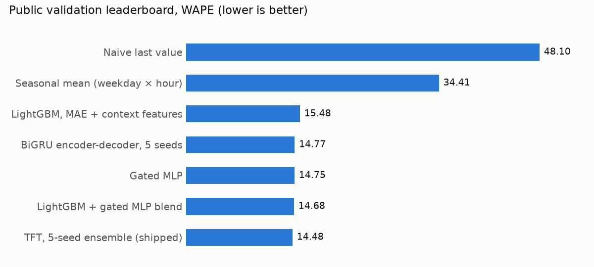
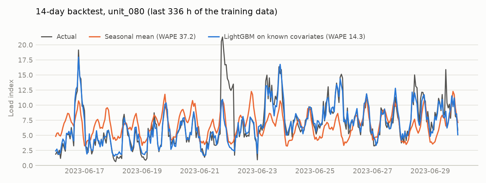

# Known-covariate forecasting

Forecasting an hourly load index for 96 operations units, 14 days (336 hours) ahead, when the
covariates for those 14 days are already known. The final model is a 5-seed Temporal Fusion
Transformer ensemble: **WAPE 14.48** on the course's public validation leaderboard, against
34.41 for the seasonal-mean baseline and 48.10 for the naive one.

Built for the deep learning bonus project at TU Darmstadt (summer 2026), then rebuilt here as
a package with tests, so every number below is either reproduced by a command in this
repository or marked as a recorded leaderboard score.

<picture>
  <source media="(prefers-color-scheme: dark)" srcset="docs/figures/leaderboard-dark.png">
  
</picture>

## The problem

- 96 hourly series, 180 days of history each (`train.csv`, 414,720 rows).
- 11 domain covariates such as `queue_pressure_forecast` and `network_pressure_forecast`.
  They are provided for the forecast block too; the target is not.
- Predict all 336 hours per series. Scored by WAPE: total absolute error over total actuals.

## Results

| Model | CV WAPE, 3 folds | Leaderboard WAPE |
|---|---|---|
| Naive last value | 54.55 ✓ | 48.10 |
| Seasonal mean (weekday × hour) | 32.95 ✓ | 34.41 |
| LightGBM, MAE loss, covariate context (experiment 4) | 14.81 ± 0.65 ✓ | 15.48 |
| BiGRU encoder-decoder, 5 seeds (experiment 11) | 14.20 ¹ | 14.77 |
| LightGBM + gated MLP blend (experiment 7) | 14.47 | 14.68 |
| **Temporal Fusion Transformer, 5 seeds (experiment 13, shipped)** | 14.72 ± 0.34 ² | **14.48** ✓ |
| Best entry on the leaderboard (another team) | | 13.05 |

✓ reproduced by this repository: CV by `loadforecast cv`; the TFT's leaderboard predictions
by `loadforecast predict` from the released checkpoints (correlation 0.999998 with the
predictions that were scored).
¹ Early-stopped on the block it reports, so optimistic by about 0.57.
² Single seed under the honest protocol (experiment 12). A single-seed TFT scored 14.36 on the
leaderboard, but that run did not keep its weights.

The full log of 13 experiments, including the ones that failed, is in
[docs/experiments.md](docs/experiments.md).

## Three findings

**1. It is a regression problem, not a sequence problem.** The first three experiments were
LSTMs rolled forward 24 hours at a time on their own predictions. None beat the seasonal
baseline. The prediction input contains every covariate for the forecast block and no target,
so target lags do not exist at prediction time. A plain linear regression on the covariates
scored WAPE 21 and beat every LSTM; LightGBM with an MAE loss and covariate leads and lags
reached 14.8.

**2. Different architectures converge to the same function.** LightGBM and XGBoost residuals
correlate at r = 0.9955; the TFT and the GRU at r = 0.973. The TFT's variable selection puts
`network_pressure_forecast` and `queue_pressure_forecast` first and the target history at
3.1%, so it does use the covariates. Past LightGBM, each new architecture bought tenths of a
point: the TFT beats the LightGBM + MLP blend by 0.2.

**3. The evaluation protocol mattered more than the model.** Early-stopping on the scored
fold made the GRU's CV 0.57 too optimistic, and CV ranked the TFT last when the leaderboard
ranked it first. A final fit whose training windows stopped short of the forecast origin cost
3.1 WAPE (17.91 to 14.77 when fixed). And retraining the same seed moves predictions by 0.40
on average, as much as averaging five seeds does, so one leaderboard submission cannot show
whether seed averaging helped. The first two are now enforced in the code and its tests.

<picture>
  <source media="(prefers-color-scheme: dark)" srcset="docs/figures/backtest-dark.png">
  
</picture>

A typical series (the one closest to the median WAPE) in the last CV fold: the seasonal
profile cannot see the load spikes; a model reading the known covariates can.

## Run it

Tested on Python 3.12. The TFT extra pins `torch 2.10.0`, `lightning 2.6.5` and
`pytorch-forecasting 1.8.0`, the versions the checkpoints were trained with.

```bash
git clone https://github.com/xitij27/known-covariate-forecasting
cd known-covariate-forecasting
python -m venv .venv && source .venv/bin/activate
pip install -e ".[tft,dev]"   # CPU-only torch: add --extra-index-url https://download.pytorch.org/whl/cpu

loadforecast download                 # dataset from Hugging Face into data/ (170 MB)
loadforecast cv                       # baselines + LightGBM, about 2 minutes on 8 CPU cores
loadforecast fetch-model              # the 5 TFT checkpoints into models/tft/ (63 MB)
loadforecast predict --model tft      # validation predictions, about 30 s on CPU
pytest                                # synthetic-data tests, about 20 s
```

`loadforecast predict --input-dir DIR` also accepts a test-style directory (`train.csv`,
`test_input.csv`, `forecast_index_test.csv`).

Retraining the TFT (`loadforecast fit-tft`) or cross-validating it (`loadforecast cv --model tft`)
needs a GPU: the shipped fit took 5.84 GPU hours on two NVIDIA T4s, about 70 minutes per seed.
[notebooks/tft-final-fit-kaggle.ipynb](notebooks/tft-final-fit-kaggle.ipynb) is the Kaggle
notebook that trained the released checkpoints.

## Layout

```
src/loadforecast/
  data.py        download, loading, backtest splits
  cv.py          rolling-origin folds; early-stop block kept apart from the scored block
  baselines.py   naive last value, seasonal mean
  features.py    covariate imputation, time encodings, leads, lags, rolling statistics
  lgbm.py        LightGBM direct regression (experiment 4)
  tft.py         TFT datasets, training, seed-ensemble inference (experiments 12 and 13)
  cli.py         the loadforecast command
tests/           synthetic panel; leakage, window and end-to-end tests
scripts/         README figures
notebooks/       exploratory data analysis; the Kaggle notebook behind the checkpoints
docs/            experiment log, figures
```

## Team

A four-person course project. The original group repository, with every notebook, is
[fabianzwinge/multivariate_timeseries_forecasting](https://github.com/fabianzwinge/multivariate_timeseries_forecasting).

- **Kshitij Parashar** (this repository): the data analysis, experiments 1 to 13, the
  cross-validation setup, the TFT training and inference pipeline, and the verified final
  archive. Shared the core-model work with Fabian Zwinge.
- **[Fabian Zwinge](https://github.com/fabianzwinge)**: core forecasting model with Kshitij,
  PatchTST experiments, final submission packaging.
- **[Ceylin Ekinci](https://github.com/jlinie)**: proposed the TFT approach and the
  additional dataset, augmentation experiments.
- **[Nikolas Diehl](https://github.com/digital-praxis)**: the exposé and the report, and the
  transfer of the TFT to a cow accelerometer dataset (WAPE 43.0 against a naive 63.8).

Claude Code and Codex were used throughout the project, as stated in the course report, and
for this rebuild.

Dataset: [AIML-TUDA/dlam-ts-project-data-2026](https://huggingface.co/datasets/AIML-TUDA/dlam-ts-project-data-2026)
(downloaded, not redistributed). Code under the MIT licence.
